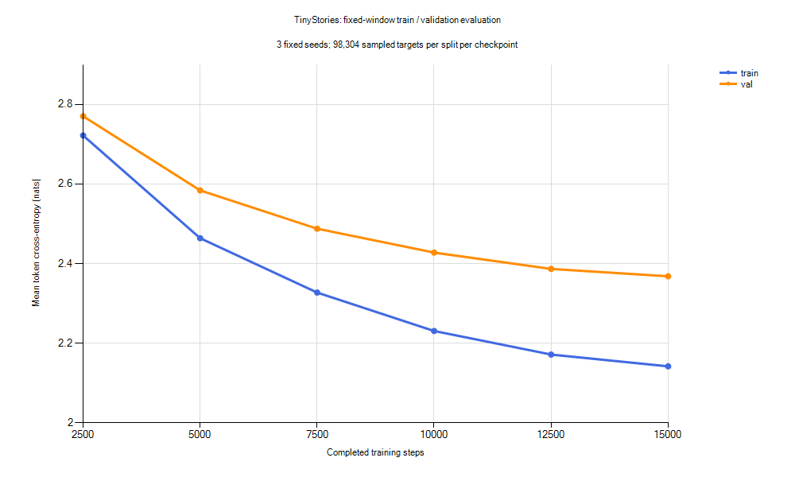

# TinyStories 同结构 15000 步实验

2026-10-25 从头运行 configs/tinystories-cpu-15000.yaml，保留之前各轮实验与原始数据。
本实验用于观察同一小型数据集上继续增加训练预算的收益，不改变模型结构。

## 预先确定的设置

- 模型：926,336 参数、2048 词表、2 层、d_model=128、4 个头、SwiGLU d_ff=352、上下文 128。
- 数据：本地 TinyStories 训练 6133 篇 / 1,341,153 tokens、验证 323 篇 / 69,576 tokens。
  仍使用仅在训练集上拟合的 tokenizer，来源与数据质量限制见 [准备记录](../docs/tinystories-local.md)。
- AMD Ryzen 9 7945HX、Windows 11；CPU FP32，OMP_NUM_THREADS=1、MKL_NUM_THREADS=1；Python 3.12.10、PyTorch 2.11.0+cpu。
- batch=8、seed=42、预热 50 步，学习率从 0.001 余弦衰减至 0.0001，weight_decay=0.1、grad_clip=1.0。
- 15000 步，每 500 步验证 4 batches，每 2500 步保存一次。
- 共计 15,360,000 个训练目标 token，包含学习率为零的第一个预热步骤。
  随机窗口有放回，约 11.45 倍语料 token 量不等于完整遍历 11.45 轮。

相较 5000 步实验，只有 max_steps、eval_interval、save_interval 和输出目录改变。
余弦终点改变意味着学习率轨迹不同；验证间隔改变也会改变训练日志中的验证采样窗口。
因此两轮不是仅增加步数的严格消融，比较使用下面独立的固定评估。

## 固定评估与复现

评估六个保存点：2500、5000、7500、10000、12500、15000。
沿用 seed=1337、2026、42，各 32 batches、batch=8、context=128，
每个 checkpoint 每份数据合计 98,304 个目标 token。
报告均值、三个种子的样本 SD 和 exp(均值 loss)；SD 不是置信区间，采样窗口也不独立。
生成沿用十条固定提示、seed=42～51、temperature=0.8、top-k=20、top-p=1、最多新增 128 tokens。

在新环境或新输出目录下复现；本机重跑应复制 YAML 并改 output_dir，避免覆盖实验：

```bash
cd /d/Python/tiny-language-model
PYTHON=/d/Python/.venvs/tiny-language-model/Scripts/python.exe
export OMP_NUM_THREADS=1
export MKL_NUM_THREADS=1
mkdir -p outputs/tinystories-cpu-15000-v1
"$PYTHON" -m tiny_lm train --config configs/tinystories-cpu-15000.yaml --dtype float32 --eval-batches 4 > outputs/tinystories-cpu-15000-v1/train.json 2> outputs/tinystories-cpu-15000-v1/train.stderr.jsonl
"$PYTHON" scripts/evaluate_tinystories.py --config configs/tinystories-cpu-15000.yaml --steps 2500 5000 7500 10000 12500 15000 --output-dir outputs/tinystories-evaluation-15000-v1
```

本轮只增加配置和实验记录，沿用已有训练、保存与评估实现，不修改数值算法、不安装依赖。

## 实测结果

训练成功完成，墙钟耗时 **987.05 秒（16 分 27 秒）**，约 **15,562 训练目标 tokens/s**。
计时包含进程启动、数据校验、训练内验证和六次保存；随后固定评估及 60 条生成另耗时 **42.21 秒**。
未测量峰值内存，GPU 未参与本轮实验。

| 本轮步数 | 训练 loss | 验证 loss | 验证 seed SD | 验证 PPL | 验证−训练 loss |
| --- | ---: | ---: | ---: | ---: | ---: |
| 2500 | 2.7220 | 2.7705 | 0.0380 | 15.97 | 0.0485 |
| 5000 | 2.4638 | 2.5840 | 0.0429 | 13.25 | 0.1202 |
| 7500 | 2.3272 | 2.4877 | 0.0443 | 12.03 | 0.1606 |
| 10000 | 2.2305 | 2.4276 | 0.0395 | 11.33 | 0.1971 |
| 12500 | 2.1713 | 2.3866 | 0.0427 | 10.88 | 0.2153 |
| 15000 | 2.1416 | **2.3680** | 0.0413 | **10.68** | 0.2264 |



曲线显示均值，纵轴从 2.0 起，不含误差条。完整数值见 [CSV](tinystories-15000-metrics.csv)。
PPL 为 exp(平均 loss)；随机窗口有放回且可能重叠，评估 token 数不代表独立样本数，也不代表遍历全验证集。

相较[上一轮 5000 步终点](tinystories-5000.md)，固定验证 loss 从 **2.5907 降到 2.3680**，改善约 0.2226，
PPL 从 13.34 降到 10.68；训练/验证差距则从 0.0832 扩大到 0.2264。
数据、tokenizer、评估窗口和生成设置保持一致，但学习率计划不同，不能把差异全部归因于步数。
本轮第 5000 步的 2.5840 也不是上一轮第 5000 步的结果。

六个候选中，15000 步验证 loss 最低，因此作为本轮首选 checkpoint；这是验证集选择结果，尚无独立测试集确认。
各保存点的验证 loss 持续下降，但最后 2500 步仅改善 0.0185，收益变小，同时训练/验证差距持续扩大。
这不等于已经出现验证 loss 回升，也不能保证继续延长训练不会过拟合；学习率衰减、数据量与模型容量的影响尚未分离。

## 生成观察

全部 **60 条生成结果**见[样本全集](tinystories-15000-samples.md)，保留完整原始文本，没有挑选性删改。

| 步数 | EOS / 10 条 | 平均新增 token | 平均重复 token 4-gram 比例 |
| --- | ---: | ---: | ---: |
| 2500 | 6 | 86.0 | 1.27% |
| 5000 | 8 | 81.2 | 2.45% |
| 7500 | 6 | 96.1 | 1.08% |
| 10000 | 7 | 99.8 | 1.49% |
| 12500 | 5 | 108.0 | 1.98% |
| 15000 | 6 | 101.0 | 0.73% |

EOS 比例和重复 token 指标都不是故事质量评分。最终十条中六条遇到 EOS，四条达到长度上限；
即使重复 4-gram 很少，也可能有语义重复、人物混乱或因果错误。
阅读最终十条样本后的观察：

- girl 能保持 Lily 和玩球的局部主题，但突然由狗回答，随后母女对话身份混乱，最终被长度上限截断。
- lost-dog 出现多个 Max，甚至“Max told Max”，没有清楚解决回家的问题。
- sharing 从分苹果转向 Tommy、Tim、蜡烛和盒子；broken-toy 没有完成修玩具的情节。
- help 起初回应捡苹果，随后转向 Lily、Tom、Sue 和球；mystery 中盒子、球和鸟的关系不断变化。
- bird 有飞向树顶的收尾，但表达仍不通顺；birthday 和 dialogue 也没有稳定回应原始故事冲突。

同一条 girl 提示的完整最终输出如下（seed=42，新增 128 tokens，因长度限制结束）：

```text
Once upon a time, there was a little girl named Lily. She loved to play with her friends. One day, she saw a big, red ball in her yard. She wanted to play with it, so it started to play.
Lily asked her friends to help her friends, "Do you want to play with my ball?" The dog said, "Yes, please!" They played and laughed together. They did not know what to do. Lily wanted to play with the ball, but she knew she would never look for one.
Lily was very sad. She asked her mom, "What are you doing, Lily?" Her mom replied, "I'm going to play
```

这些观察只覆盖固定十条提示、每条一个生成种子，没有盲评或训练文本记忆检测。
loss 改善明确，但本轮仍未得到能够稳定讲述连贯故事的模型。

## 产物与验证

- outputs/tinystories-cpu-15000-v1/：六个 checkpoint、train.json、train.stderr.jsonl、原始/解析配置快照、run.json 和 verification.json。
  本轮首选权重为 step_00015000.pt。
- run.json 记录实际命令、环境、耗时、输入哈希及运行时 Git 状态；源码 HEAD 为
  `5f3ccaa2bfef06d0c8f2cf4fc6cabfce855980ab`，另有上一轮评估/绘图脚本和本轮配置、实验文档等未提交改动。
- outputs/tinystories-evaluation-15000-v1/：report.json、metrics.csv、samples.md；
  包含 36 组 seed 指标、60 份生成 token IDs、输入/权重 SHA-256 和运行绑定。
- 本文、配置、CSV、PNG 和全部样本文本纳入版本控制范围；权重、语料和本地运行 JSON 仍由现有规则忽略。
- 15000 条日志步数完整、loss 有限；六个 checkpoint 均完成加载与评估。
  三轮实验的评估协议和输入绑定一致，22 个来源文件哈希核对通过，旧配置、数据、提示和权重均保持完整。
  文档中的 CSV 与样本副本和原始评估输出逐字节一致，曲线已检查。
- 本轮实际训练、固定评估、配置校验、Ruff、格式和 diff 空白检查通过。
  未重跑完整单元测试，也未重新做 15000 步中断续训逐位对照。

下一步优先核对并扩充语料、保留独立评估数据，再用相同结构进行对照。
本地 5M 样本仅做了完全相同故事去重，上游版本与近似重复仍待核实；
当前结果不足以确定主要瓶颈是数据还是模型容量，不建议直接把同一小语料的训练拉长到一小时。
