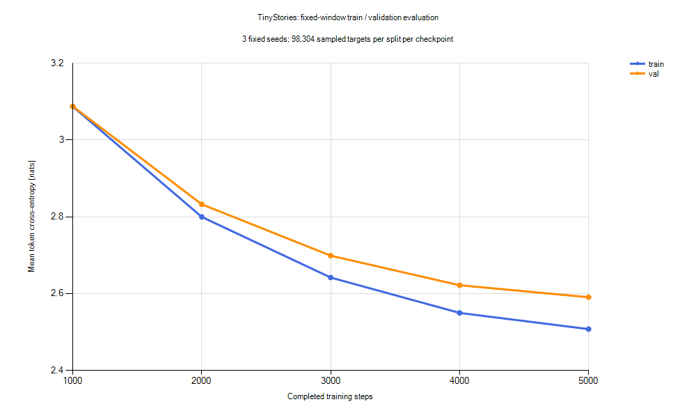

# TinyStories 同结构 5000 步实验

2026-10-25，从头运行 configs/tinystories-cpu-5000.yaml，保留既有 1000 步基线的全部文件。
模型、数据、tokenizer、batch、初始化种子和优化器参数与基线相同。

## 设置与比较范围

- 926,336 参数，2 层、128 维、4 个头、SwiGLU 352 维、词表 2048、上下文 128。
- 本地 TinyStories：训练 6133 篇 / 1,341,153 tokens；验证 323 篇 / 69,576 tokens。
  来源、划分与去重限制见 [数据记录](../docs/tinystories-local.md)。
- CPU FP32，OMP_NUM_THREADS=1、MKL_NUM_THREADS=1；Windows、Python 3.12.10、PyTorch 2.11.0+cpu。
- batch=8、seed=42、预热 50 步、learning_rate=0.001、min_learning_rate=0.0001，
  weight_decay=0.1、grad_clip=1.0；每 100 步验证 4 batches，每 1000 步保存。
- 相比原基线，仅训练终点从 1000 改为 5000、保存间隔从 250 改为 1000，输出采用新目录。
  由于余弦衰减终点改变，学习率轨迹不同，这不是仅改变累计更新次数的严格消融。
- 训练目标 token 数为 5,120,000，包含学习率为零的首个预热步骤；有放回窗口采样不能视为完整遍历或独立覆盖。

固定评估沿用 [前次评估](tinystories-evaluation.md)：3 个种子各 32 batches，
每个 checkpoint 的训练/验证各 98,304 个目标 token。SD 描述三个种子的采样波动，不是置信区间。
10 条提示、种子 42～51、temperature=0.8、top-k=20、top-p=1、最多新增 128 tokens 均保持不变。
训练日志的采样窗口持续变化，因此不会直接把间隔验证日志作为固定窗口比较结果。

## 复现

在尚不存在该输出的环境中运行；本机重跑应复制 YAML 并改为新的 output_dir，避免覆盖已有实验：

```bash
cd /d/Python/tiny-language-model
PYTHON=/d/Python/.venvs/tiny-language-model/Scripts/python.exe
export OMP_NUM_THREADS=1
export MKL_NUM_THREADS=1
mkdir -p outputs/tinystories-cpu-5000-v1
"$PYTHON" -m tiny_lm train --config configs/tinystories-cpu-5000.yaml --dtype float32 --eval-batches 4 > outputs/tinystories-cpu-5000-v1/train.json 2> outputs/tinystories-cpu-5000-v1/train.stderr.jsonl
"$PYTHON" scripts/evaluate_tinystories.py --config configs/tinystories-cpu-5000.yaml --steps 1000 2000 3000 4000 5000 --output-dir outputs/tinystories-evaluation-5000-v1
```

评估脚本新增 --steps 参数，默认仍为旧的 250、500、750、1000；拒绝非正数、重复或非升序列表。
评估输出目录必须不存在。绘图脚本增加坐标范围参数，保留旧图的默认范围。
本次未修改训练、损失、优化器、采样或模型算法，也未安装新依赖。

## 实测结果

训练已完成，命令墙钟耗时 **343.33 秒（约 5 分 43 秒）**，包含启动、数据校验、
训练内验证和五次保存；处理 5,120,000 个训练目标 token，约 **14,913 tokens/s**。
随后五个 checkpoint 的固定评估及 50 条生成合计 **36.48 秒**，不计入训练时间。
没有测量峰值内存；GPU 没有参与或验收。

| 本轮步数 | 训练 loss | 验证 loss | 验证 seed SD | 验证 PPL | 验证−训练 loss |
| --- | ---: | ---: | ---: | ---: | ---: |
| 1000 | 3.0873 | 3.0877 | 0.0373 | 21.93 | 0.0004 |
| 2000 | 2.7998 | 2.8327 | 0.0387 | 16.99 | 0.0329 |
| 3000 | 2.6419 | 2.6988 | 0.0370 | 14.86 | 0.0569 |
| 4000 | 2.5498 | 2.6218 | 0.0381 | 13.76 | 0.0721 |
| 5000 | 2.5075 | **2.5907** | 0.0399 | 13.34 | 0.0832 |



曲线显示均值，纵轴从 2.4 起，不含误差条。完整数值见 [CSV](tinystories-5000-metrics.csv)。
PPL 为 exp(平均 loss)，仅在相同 tokenizer 与评估方法下比较。
随机窗口有放回且可能重叠，不能把预测 token 数当作独立样本量，亦未遍历全验证集。

原 1000 步实验终点的固定评估为训练 3.2595、验证 **3.2358**，本轮终点验证为 **2.5907**。
两轮共享同一份数据与 tokenizer、固定窗口和提示词，源文件哈希与运行绑定已核对一致。
本轮第 1000 步也与旧实验终点不同，体现了余弦计划变化；不要把两个同名步数 checkpoint 混淆。

本轮五个候选中，5000 步验证 loss 最低。训练和验证 loss 继续下降，但差距逐渐扩大，
最后 1000 步验证 loss 仅改善约 0.0312；尚未出现验证 loss 回升，
也不能据此保证继续增加步数不会过拟合。学习率衰减、数据量和模型容量的影响尚未分离。

## 生成观察

全部 **50 条生成结果**保存在 [样本全集](tinystories-5000-samples.md)，没有挑选性删改。

| 步数 | EOS / 10 条 | 平均新增 token | 平均重复 token 4-gram 比例 |
| --- | ---: | ---: | ---: |
| 1000 | 6 | 85.6 | 0.75% |
| 2000 | 8 | 72.0 | 1.02% |
| 3000 | 7 | 86.8 | 1.47% |
| 4000 | 7 | 83.8 | 0.00% |
| 5000 | 7 | 88.0 | 0.24% |

重复代理指标的定义及其局限沿用前次评估；0% 也不等于没有语义重复或逻辑错误。
旧实验终点 EOS 为 4/10，本轮终点为 7/10，但 EOS 比例不是故事完整性评分。

阅读最终十条样本后的观察：

- girl 提示能保持 Lily 主体一段时间，也出现完整句式和结尾，但中间仍有不通顺表达与逻辑跳跃。
- lost-dog 开头能回应迷路和悲伤，随后转向 Tim、球与玩具，未在长度上限内完成清楚的回家过程。
- sharing 仅新增 11 tokens 即结束，没有展开分苹果的情节；提前 EOS 不能当作任务完成。
- broken-toy 仍转向 Tom、Lily、球和怪物；rain 突然出现 dragon；help 也偏离老人掉苹果的情境。
- 多条样本出现语法错误、指代不清或拼造词；句子流畅度和故事一致性仍不能稳定保证。

同一条原始 girl 提示的完整最终输出如下（seed=42，112 个新增 token 后 EOS）：

```text
Once upon a time, there was a little girl named Lily. She loved to play with her friends. One day, she saw a big, red ball in the yard. She was sad because she had lost her favorite toy.
Lily had an idea. She thought she was a very much. She was very happy. Her mom said, "Sure, we will give it back soon," she said.
They played with the ball. Lily went to the stupid. They would sit on the ball and look at the ball in the park. They became good friends. The end.<|endoftext|>
```

这里只对固定十条提示、每条一个采样种子进行了定性检查，没有盲评或训练文本记忆检测。

## 产物和验证

- outputs/tinystories-cpu-5000-v1/：第 1000、2000、3000、4000、5000 步 checkpoint，
  train.json、train.stderr.jsonl、原文/解析配置快照与 run.json。
- run.json 记录实际命令、环境、源码 HEAD、当时未提交文件列表、耗时、返回码和输入哈希。
  本轮 HEAD 为 `5f3ccaa2bfef06d0c8f2cf4fc6cabfce855980ab`，另有新配置和评估/绘图脚本未提交改动。
- outputs/tinystories-evaluation-5000-v1/：report.json、metrics.csv、samples.md；
  包含 30 组 seed 指标、50 份生成 token IDs、输入/权重 SHA-256 和运行绑定。
- 本文、CSV、PNG 和全部样本文本进入 Git；权重、语料及本地运行 JSON 仍由现有规则忽略。
- 5000 条训练日志步数完整且 loss 有限；5 个 checkpoint 经加载与输入绑定检查，
  训练前后数据一致、评估前后输入与权重一致，旧实验文件哈希也未改变。
- 实际训练和五 checkpoint 评估成功；--steps 非法输入检查、Ruff、格式、紧凑码风和 diff 空白检查通过。
  本轮没有重跑完整单元测试，也没有重复进行 5000 步的中断续训逐位对照。

下一步建议先扩大或核对语料并保留独立评估数据，再以同结构做对照。
这份本地 5M 样本仅做了完全相同故事去重，上游版本与近似重复尚未核实；
当前结果不能单独确定限制主要来自语料、模型容量还是训练预算，不建议仅据 loss 曲线无限增加步数。

2026-10-25 后续已完成[同结构 15000 步实验](tinystories-15000.md)：训练耗时 16 分 27 秒，固定验证 loss 为 2.3680。
该实验从头运行并采用更长的余弦计划，本页保留原 5000 步实验结果。
