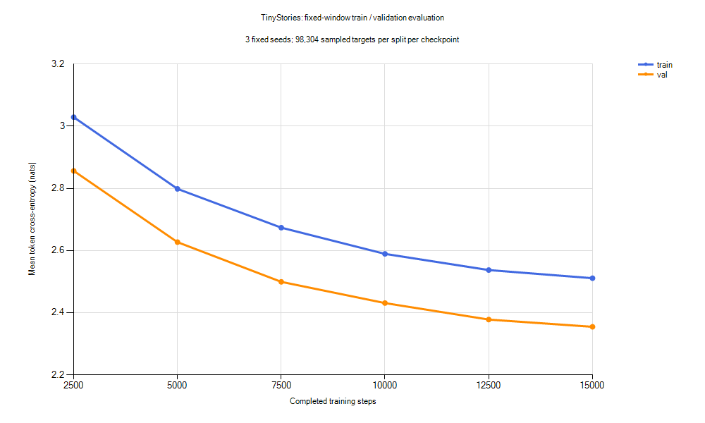

# TinyStories 5 万篇、15000 步数据对照

2026-10-25 开始，从头运行 configs/tinystories-cpu-50k.yaml。
本轮检验在相同模型和训练预算下增加故事数量的效果，不继续追加训练时间。

## 预定配置与评价

- AMD Ryzen 9 7945HX、Windows 11、Python 3.12.10、PyTorch 2.11.0+cpu；CPU FP32、OMP_NUM_THREADS=1、MKL_NUM_THREADS=1。
- 926336 参数，词表 2048、2 层、128 维、4 头、SwiGLU 352 维、上下文 128。
- 50000 篇训练故事，12,046,442 tokens，包含原 6133 篇；来源与过滤规则见[数据准备记录](../docs/tinystories-expanded.md)。
- 原验证集 323 篇、69,576 tokens，原 tokenizer 与验证文件逐字节保持一致。
- batch=8、seed=42、15000 步、预热 50 步、余弦学习率 0.001 到 0.0001、weight_decay=0.1、grad_clip=1。
- 每 500 步验证 4 batches、每 2500 步保存一次。与原 15000 步实验的 model、training 配置逐项一致。
- 训练目标总量为 15,360,000 tokens，约为新语料 token 量的 1.28 倍；有放回窗口采样不代表完整遍历。
- 训练预算约 20 分钟，外层进程设置 1800 秒超时；超时终止并保留已写日志及定期 checkpoint，不保证保存终止瞬间状态。

固定评价沿用 2500、5000、7500、10000、12500、15000 六个 checkpoint，
seeds=1337/2026/42，每种子 32 batches，每个划分共 98,304 个目标 token。
原验证文件相同，因此新旧模型的验证窗口一致；训练数据变长，训练 loss 的抽样对象不同，不能把训练差距直接当作同一集合上的改善。
三个种子的样本 SD 仅描述窗口抽样波动，不是训练种子间波动或置信区间。

沿用原十条固定生成提示、seed=42～51、temperature=0.8、top-k=20、top-p=1、最多新增 128 tokens。
保存六个 checkpoint 的全部 60 条生成，不挑选性删改。
完成固定验证后，各轮只按验证 loss 选一个 checkpoint，再在预留 1000 篇故事上各评估一次。
留出集也用三个固定种子各 32 batches，不能用该结果反过来挑选本轮保存点。

## 复现

以下命令仅在新输出目录或新环境运行；本机已有输出不可覆盖，重跑需复制 YAML 并修改 output_dir。

```bash
cd /d/Python/tiny-language-model
PYTHON=/d/Python/.venvs/tiny-language-model/Scripts/python.exe
export OMP_NUM_THREADS=1
export MKL_NUM_THREADS=1
mkdir -p outputs/tinystories-cpu-50k-v1
"$PYTHON" -m tiny_lm train --config configs/tinystories-cpu-50k.yaml --dtype float32 --eval-batches 4 > outputs/tinystories-cpu-50k-v1/train.json 2> outputs/tinystories-cpu-50k-v1/train.stderr.jsonl
"$PYTHON" scripts/evaluate_tinystories.py --config configs/tinystories-cpu-50k.yaml --steps 2500 5000 7500 10000 12500 15000 --output-dir outputs/tinystories-evaluation-50k-v1
"$PYTHON" scripts/evaluate_tinystories_heldout.py --reports outputs/tinystories-evaluation-15000-v1/report.json outputs/tinystories-evaluation-50k-v1/report.json --heldout data/tinystories-expanded-50k-v1/heldout.bin --tokenizer data/tinystories-expanded-50k-v1/tokenizer.json --output outputs/tinystories-evaluation-50k-v1/heldout.json
```

上面的直接训练命令本身不带超时；本次实际运行由外层 subprocess 的 1800 秒限时控制。
原始命令、输入哈希、配置快照、Git revision、未提交改动和耗时记录在训练目录的 run.json。
没有修改核心模型或训练算法，没有安装新依赖；本次新增独立留出评价脚本。

## 实际运行与完整性

15000 步训练成功完成，耗时 **1491.07 秒（24 分 51 秒）**，未触及 1800 秒终止上限。
共处理 15,360,000 个训练目标 tokens，约 **10,301 tokens/s**。
该计时包含 CLI 启动、数据校验、训练内验证和保存，不包括随后固定评估与留出评价。
同机器前一轮耗时 987.05 秒；本轮更慢，但未做系统负载与性能剖析，不能将差异全部归因于数据量。
未测峰值内存、CPU 温度或功耗，没有 GPU 参与。

15000 条训练日志步数连续、loss 有限，六份 checkpoint 均已保存。
本轮验证间隔始终为 500 步，共 30 次；用户中途提出以后改为 2500 步，随后明确本轮保持原设置。
后续新实验若开展，再采用较疏的验证间隔并单独记录，不回改本轮配置。
所有已记录的输入和源码文件哈希在训练后保持一致。

运行时 Git HEAD 为 `8516dccdcb95a7c739ed23e0bcce86d02a6ea7d8`，另有扩充数据脚本、配置、测试及文档等未提交改动。
训练目录保存 run.json、working-tree.diff、config.source.yaml、config.resolved.json、train.json 和 train.stderr.jsonl。
run.json 包含运行时源码文件哈希；新增留出评价脚本在训练启动后编写，不影响已启动的训练程序。

## 固定验证结果

六个 checkpoint 的固定评价及 60 条生成合计 **78.62 秒**，不计入训练时间。

| 步数 | 训练 loss | 验证 loss | 验证 seed SD | 验证 PPL | 验证−训练 loss |
| --- | ---: | ---: | ---: | ---: | ---: |
| 2500 | 3.0289 | 2.8561 | 0.0231 | 17.39 | -0.1728 |
| 5000 | 2.7983 | 2.6269 | 0.0304 | 13.83 | -0.1713 |
| 7500 | 2.6735 | 2.4991 | 0.0291 | 12.17 | -0.1744 |
| 10000 | 2.5891 | 2.4309 | 0.0292 | 11.37 | -0.1583 |
| 12500 | 2.5371 | 2.3778 | 0.0313 | 10.78 | -0.1593 |
| 15000 | 2.5109 | **2.3546** | 0.0306 | **10.53** | -0.1564 |



曲线纵轴从 2.2 起，显示均值、不含误差条；完整数值见 [CSV](tinystories-50k-metrics.csv)。
PPL 为 exp(平均 loss)，仅在相同词表和评价协议下比较。
本轮六个保存点中第 15000 步验证 loss 最低；上一轮亦为第 15000 步最低，因此独立留出评价使用这两份模型。
最后 2500 步验证 loss 改善约 0.0232，没有观察到保存点间验证 loss 回升。

原验证集上的改善只有 **0.0135**，不能仅凭这一小幅变化声称故事能力显著提升。
本轮训练 loss 高于验证 loss：训练集合扩大并改变了内容组成，旧验证集只来自原本地小样本。
因此负差值不能解释为“过拟合已经解决”，也不能将其与旧模型在小训练集上的差值直接作同集合比较。

## 独立留出集对照

选定 checkpoint 后才评价预留的 1000 篇故事，两模型使用完全相同的 98,304 个抽样目标。
本次留出评价合计 **9.43 秒**，逐种子结果与输入/权重哈希见 [完整 JSON](tinystories-50k-heldout.json)。

| 指标 | 旧 6133 篇 / 15000 步 | 新 50000 篇 / 15000 步 |
| --- | ---: | ---: |
| 原验证集 loss | 2.3680 | 2.3546 |
| 原验证集 PPL | 10.68 | 10.53 |
| 独立留出 loss | 2.7094 | **2.4873** |
| 独立留出 seed SD | 0.0284 | 0.0264 |
| 独立留出 PPL | 15.02 | **12.03** |
| 训练墙钟时间 | 16 分 27 秒 | 24 分 51 秒 |

留出 loss 改善约 **0.2222**，三个配对采样种子下均改善，支持扩充数据有助于这份未参与训练的故事样本。
这是一次训练种子、一个固定抽样留出集的结果；没有重复训练、置信区间或显著性检验。
留出集是官方验证文本的有界抽样，不是官方全验证集；本地原始样本来源、抽样偏差与词面去重限制见数据文档。
训练量固定，数据量和组成同时变化，所以不能把收益严格分解为故事数量或内容多样性。

## 生成质量与局限

全部 **60 条完整生成**见[样本全集](tinystories-50k-samples.md)，所有原提示、种子与采样参数均保持一致。

| 步数 | EOS / 10 条 | 平均新增 tokens | 平均重复 token 4-gram 比例 |
| --- | ---: | ---: | ---: |
| 2500 | 6 | 108.7 | 0.99% |
| 5000 | 3 | 118.0 | 1.17% |
| 7500 | 4 | 89.5 | 1.60% |
| 10000 | 4 | 119.9 | 2.75% |
| 12500 | 4 | 112.0 | 1.30% |
| 15000 | 3 | 108.4 | 2.41% |

最终十条中只有三条遇到 EOS，七条达到长度上限；旧模型相同提示下是六条遇到 EOS。
重复 token 4-gram 从旧模型终点的约 0.73% 增至 2.41%。这两个代理指标不等于故事质量评分，但不支持“生成全面变好”的说法。
逐条阅读最终样本后的观察：

- girl 从 Daisy、Lisa、Mia 跳到 Penny，局部句子成立，人物身份没有稳定保持。
- lost-dog 未解决回家问题，猫、狗和主人混淆，并出现“the dog is broken”。
- sharing 很快结束，出现 lawyer 和拼造词，没有完成分苹果情节；broken-toy 反复道歉，人物切换，未修好玩具。
- rain 转向球、石头、蜡烛和汽车；birthday 对话循环，没有清楚的生日事件。
- help 偏离帮助老人捡苹果的主题；mystery 混合盒子、树、汽车和人物，含不通顺词句。
- bird 保留飞翔主题但反复指代同一只鸟；dialogue 的情绪和因果仍不合理。

定性检查只涵盖十条固定提示、每条一个生成种子，没有盲评或记忆检测。
可以说独立留出 loss 改善了，**不能说模型已经能够稳定讲述连贯故事**。

## 验收与后续

- 训练 15000 步、六 checkpoint 固定评估、两模型独立留出评估均成功。
- 固定验证数据、词表、评价参数与提示种子和上一轮一致；训练数据按计划变化。
- 36 组训练/验证 seed 指标、60 条样本已核对；数据和权重哈希在评价前后不变，旧实验文件保留完整。
- 发布到 experiments/ 的 CSV、样本及留出 JSON 与本地原始输出逐字节一致，曲线已检查。
- 配置核对、Ruff、格式和 diff 空白检查通过；未重跑全量单元测试，也未追加本轮中断续训逐位对照。

本轮已达到约定的个人笔记本实验终点：固定预算下完成数据规模对照，并记录收益与局限。
**先停止追加训练并整理项目，不自动扩充数据、增加步数或启动下一轮。**
若以后有明确实验问题再运行，训练中验证间隔优先改为 2500 步，并保留单轮时间预算。
