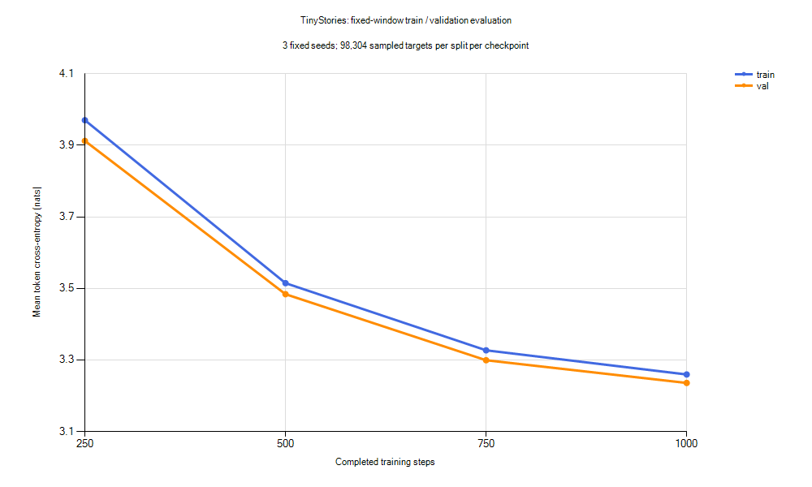

# TinyStories 四个 checkpoint 的固定评估

2026-10-24 完成，仅读取现有 250、500、750、1000 步 checkpoint，没有重新训练。
本轮目标是比较同一次训练过程中的模型，检查训练/验证差距，并保留固定提示的全部生成结果。

## 方法

- 使用 configs/tinystories-cpu.yaml 对应的 926,336 参数模型，以及原有训练/验证 token 文件。
- Windows、Python 3.12.10、PyTorch 2.11.0+cpu，CPU FP32、OMP/MKL/PyTorch 单线程。
- 两个数据集都在 eval 模式下评估；每个 seed 都重新创建独立采样器。
- 固定 seed=1337、2026、42，各评估 32 batches，batch=8、context=128。
  每个 checkpoint 每个数据集合计 98,304 个目标 token；所有 checkpoint 使用同样的窗口集合。
- 表中 loss 是三组等量 token 评估的均值，SD 是三个 seed 结果的样本标准差。
  SD 仅描述采样波动，不是置信区间。PPL 为 exp(平均 loss)，只适合同一 tokenizer/评估方法下比较。
- 随机窗口有放回且可能重叠；验证数据只有 69,576 tokens，不能把 98,304 次目标预测当成独立样本或完整遍历。
- 用 checkpoint v2 核对实际数据、tokenizer 与训练运行绑定；所有输入文件与 checkpoint 的运行前后 SHA-256 一致。
- 提示词预先固定在 [tinystories-prompts.json](tinystories-prompts.json)，覆盖迷路、分享、坏玩具、雨天、
  学飞、生日、帮助、发现物品和对话等场景。每条提示的 seed 为 42+索引，在四个 checkpoint 间保持一致。
  temperature=0.8、top-k=20、top-p=1、最多新增 128 tokens，遇到 EOS 即结束。

## 数值结果

| 更新步数 | 训练 loss | 验证 loss | 验证 seed SD | 验证 PPL | 验证−训练 loss |
| --- | ---: | ---: | ---: | ---: | ---: |
| 250 | 3.9700 | 3.9122 | 0.0293 | 50.01 | -0.0578 |
| 500 | 3.5147 | 3.4839 | 0.0287 | 32.59 | -0.0309 |
| 750 | 3.3270 | 3.2993 | 0.0313 | 27.09 | -0.0278 |
| 1000 | 3.2595 | 3.2358 | 0.0323 | 25.43 | -0.0237 |



曲线以 Windows .NET Charting 从 [指标 CSV](tinystories-evaluation-metrics.csv) 绘制，纵轴从 3.1 起，
显示均值、不显示误差条；完整 seed 指标与源文件哈希保存在本地 report.json。
本轮评估和 40 条生成合计约 48.05 秒，不包含随后绘图和文档整理。

**本次四个候选中，第 1000 步的验证 loss 最低。** 训练和验证 loss 都在下降，
没有出现训练 loss 下降而验证 loss 回升的明显过拟合迹象。
验证略低于训练可能与两份语料及所抽取窗口难度不同有关，不能据此保证不存在过拟合或数据问题。
原划分只做了完全相同故事去重，没有完成近似重复排查。

最后 250 步验证 loss 仍下降约 0.0635。降幅变小的同时原学习率也在衰减，
不能只看曲线变平就判断已充分收敛，也不能保证延长训练一定改善。
原基线的 3.2367 来自单个 seed、16 batches；本轮 3.2358 来自三个 seed、各 32 batches，
两者是不同窗口集合的估计，不能把这点差别当成模型再次进步。

## 生成结果

全部 **40 条结果**见 [生成全集](tinystories-evaluation-samples.md)，未删去失败样本或只挑较好结果。

| 步数 | 遇到 EOS / 10 条 | 平均新增 token | 平均重复 token 4-gram 比例 |
| --- | ---: | ---: | ---: |
| 250 | 6 | 80.3 | 1.11% |
| 500 | 5 | 100.4 | 0.46% |
| 750 | 2 | 111.6 | 0.80% |
| 1000 | 4 | 97.7 | 0.96% |

重复指标仅计算新增部分，去掉末尾 EOS，对连续四个 BPE token 的序列使用
`1 - 不同序列数/总序列数`，再对十条样本取均值。它不能识别同义重复、情节重复或语法错误，
也受输出长度影响；低重复率不是故事质量评分。EOS 次数仅反映停止行为，不等于完整故事数。

逐条阅读后的观察：

- 250 步已出现常见故事词汇，但有明显残句与人物代词冲突。
- 500～1000 步可出现较完整句式，改善并非在每条提示上单调发生。
- 1000 步仍多次忽略核心情境：迷路小狗很快变为 Lily 的故事；坏玩具没有获得连贯的修复情节；
  老人掉苹果的情境转为玩具盒、小鸟和球，人物与对象频繁变化。
- 1000 步雨天样本仅新增 13 tokens 即结束，结束符正常但故事发展不足；另有 6 条达到 128 token 上限。
- 生日与对话提示仍有对话归属混乱、主谓关系错误等问题。不能因 loss 下降而将其描述为可靠故事生成。

这只是十条人工编写提示、每条一个固定采样种子的定性检查，没有盲评或标准化人工评分，
不代表所有提示上的表现，也不衡量训练文本记忆程度。

## 复现与产物

```bash
cd /d/Python/tiny-language-model
PYTHON=/d/Python/.venvs/tiny-language-model/Scripts/python.exe
"$PYTHON" scripts/evaluate_tinystories.py --output-dir outputs/tinystories-evaluation-v2
```

脚本默认读取当前四份 checkpoint 和固定提示词；输出目录必须不存在。
本轮产物位于 outputs/tinystories-evaluation-v1/：report.json、metrics.csv、samples.md。
完整报告包含每组 seed 的指标、40 份 token IDs、采样参数、源文件哈希和 tokenizer/数据绑定。
CSV、全部文本样本和 PNG 副本随本实验文档进入 Git；原 checkpoint、语料与本地 JSON 报告继续被忽略。

Windows 下可用 scripts/plot_tinystories_evaluation.ps1 绘图，传入 MetricsPath 和新的 ImagePath；
它使用系统 .NET Charting，无需安装 Python 绘图库，拒绝覆盖已有图片。
本机脚本执行策略限制直接运行 ps1，绘图使用了单独 PowerShell 进程的 ExecutionPolicy Bypass，
未改变用户或系统持久执行策略。

本次不修改模型、采样或训练算法。已有 API 在实际评估中成功运行，输入/权重哈希保护、
数据绑定与产物一致性检查通过；Ruff、格式和紧凑码风检查通过，未重复执行全量单元测试。
另按原基线的单 seed、16 batches 重评，loss 与原记录逐位相等；1000 步 girl 提示生成的前 64 个新增 token 也与原样本完全一致。

## 下一步建议

保留本轮为固定评估基准，下一轮可先运行同结构的 **5000 步候选实验**，使用新的输出目录和预先确定的学习率计划，
再对照本轮相同窗口与提示。不能直接改旧配置的 max_steps 后恢复已经结束的 1000 步 checkpoint。
这是基于仍在下降的验证 loss 提出的试验，不是对效果的保证；若后续训练/验证差距明显扩大，
则优先扩充和核对数据，而不是继续增加步数。本轮尚未启动该训练。

2026-10-25 更新：上述 5000 步实验已完成，详见 [训练与固定评估结果](tinystories-5000.md)。
